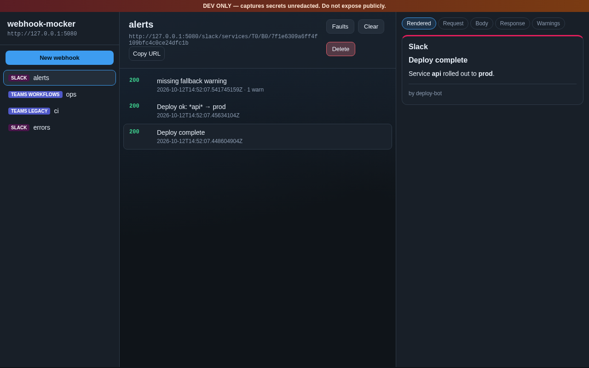
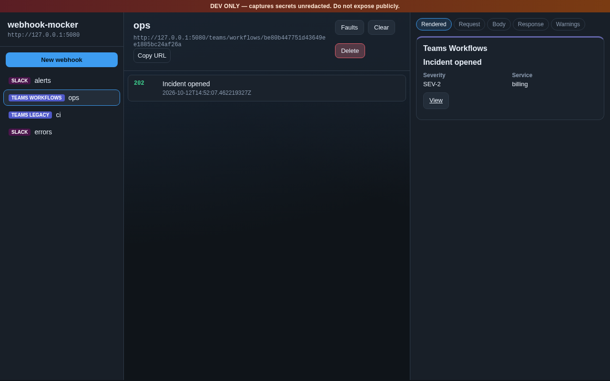
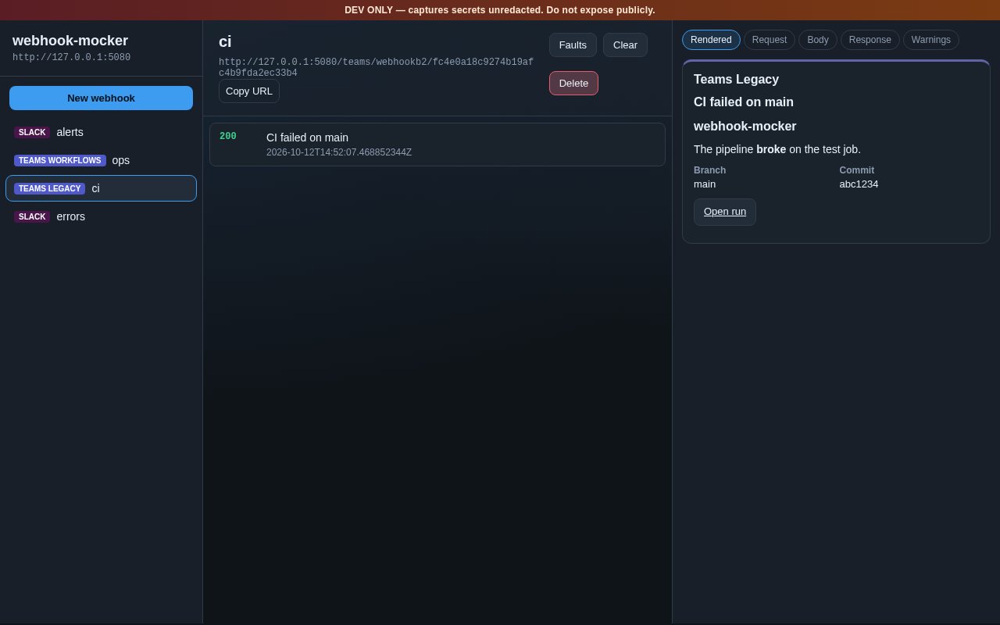
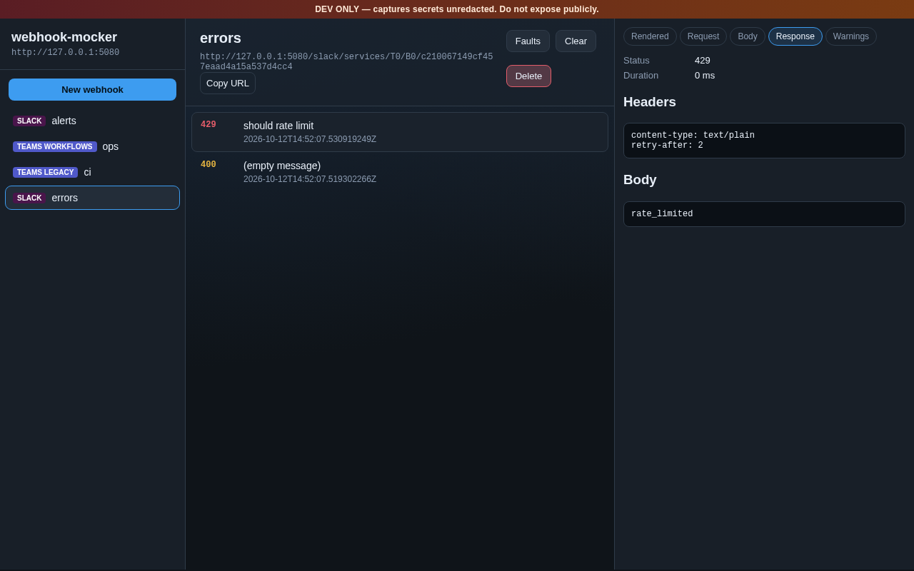
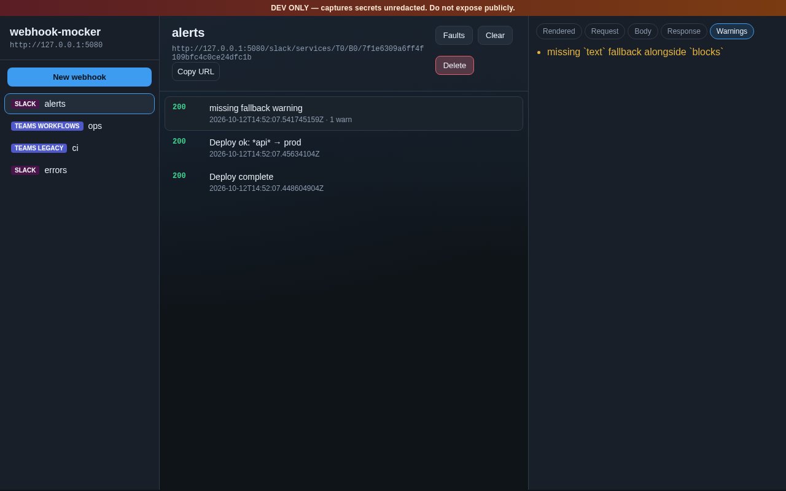
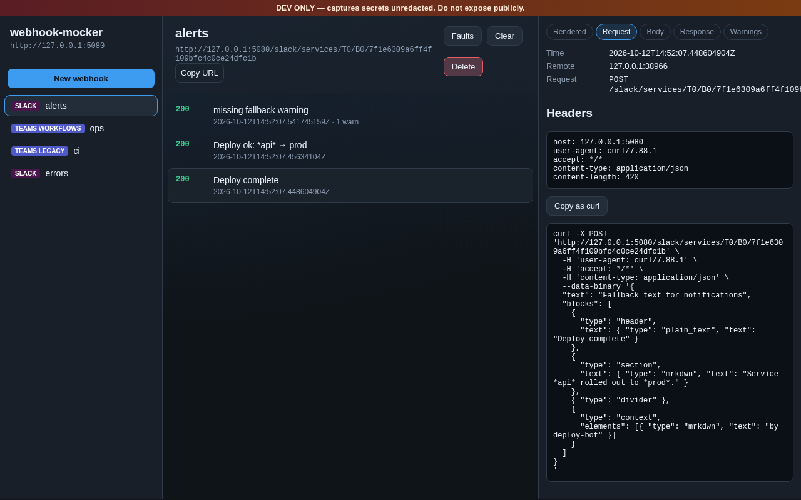
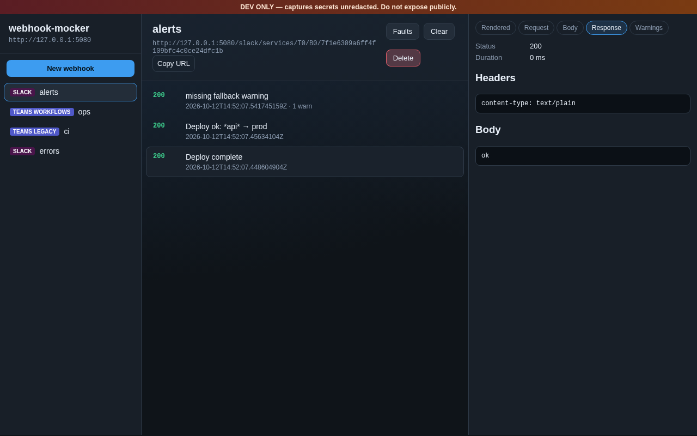

# webhook-mocker

Dev-only Slack and Microsoft Teams incoming-webhook mocker with a live virtual-channel UI.

Every request is captured with full debug data (headers, raw body, parsed JSON, validation warnings, exact response).

**Do not expose this on the public internet.** Secrets are stored unredacted.

Contributing or hacking on the source? See [DEVELOPMENT.md](DEVELOPMENT.md).

## Install

Download a binary from [GitHub Releases](https://github.com/davidgroves/webhook-mocker/releases), or pull the container:

| Platform | Artifact |
|---|---|
| Linux amd64 / arm64 (static musl) | `webhook-mocker-<version>-linux-amd64.tar.gz` / `…-linux-arm64.tar.gz` |
| macOS arm64 | `webhook-mocker-<version>-darwin-arm64.tar.gz` |
| Windows amd64 | `webhook-mocker-<version>-windows-amd64.zip` |
| Container (`linux/amd64`, `linux/arm64`) | `ghcr.io/davidgroves/webhook-mocker:<version>` |

```bash
# Binary (example: Linux amd64)
tar -xzf webhook-mocker-*-linux-amd64.tar.gz
chmod +x webhook-mocker
./webhook-mocker

# Container
docker pull ghcr.io/davidgroves/webhook-mocker:latest
docker run --rm -p 5080:5080 -e WM_PUBLIC_URL=http://localhost:5080 \
  ghcr.io/davidgroves/webhook-mocker:latest
```

UI: http://127.0.0.1:5080/

## Quick start

Point your app at a webhook URL on that host:

| Provider | URL shape | Success response |
|---|---|---|
| Slack Incoming Webhooks | `POST /slack/services/{T}/{B}/{token}` | `200` body `ok` |
| Teams Workflows | `POST /teams/workflows/{id}` | `202 Accepted` |
| Teams legacy O365 connector | `POST /teams/webhookb2/{id}` | `200` body `1` |
| Generic | `ANY /hooks/{id}` | `200` `{"ok":true}` |

Channels are **auto-created on first hit** by default. You can also create them in the UI or via the API.

```bash
# Preset channels at startup
./webhook-mocker --channel slack:alerts --channel teams:ops
```

## Configuration

Settings load in this order (later wins): **defaults → YAML file → `WM_*` env → CLI flags**.

### YAML file

Pass a file with `--config` / `-c`, or `WM_CONFIG`. If neither is set, `./webhook-mocker.yaml` (or `.yml`) is loaded when present. See [`webhook-mocker.example.yaml`](webhook-mocker.example.yaml).

```yaml
listen: 0.0.0.0:5080
public_url: http://localhost:5080
channels:
  - slack:alerts
  - kind: teams
    name: ops
  # Stable path + fault profile (defect) applied at startup
  - kind: slack
    name: flaky
    token: flaky-token
    slack_team: T0
    slack_bot: B0
    faults:
      force_429: true
      retry_after_secs: 2
  - kind: generic
    name: slow
    token: slow-hook
    faults:
      delay_ms: 1500
      fail_percent: 25
      status: 503
strict: false
auto_create: true
max_messages: 500
max_body: 1048576
json_logs: false
```

Channel `faults` uses the same fields as `POST /api/channels/{id}/faults` (`force_429`, `retry_after_secs`, `delay_ms`, `delay_random_ms`, `status`, `fail_percent`). Optional `token` / `slack_team` / `slack_bot` pin a stable webhook URL.

```bash
./webhook-mocker --config ./webhook-mocker.yaml
./webhook-mocker -c ./webhook-mocker.yaml --listen 127.0.0.1:5080
```

### Flags and environment

| Flag / env | Default | Description |
|---|---|---|
| `--config` / `-c` / `WM_CONFIG` | `./webhook-mocker.yaml` if present | YAML config path |
| `--listen` / `WM_LISTEN` | `127.0.0.1:5080` | Bind address (container image defaults to `0.0.0.0:5080`) |
| `--public-url` / `WM_PUBLIC_URL` | derived from listen | Base URL printed in the UI |
| `--channel KIND:NAME` | — | Startup channels (replaces `channels` from the file when set) |
| `--strict` / `WM_STRICT` | `false` | Turn validation warnings into hard errors |
| `--auto-create` / `WM_AUTO_CREATE` | `true` | Auto-create channels on first hit |
| `--max-messages` / `WM_MAX_MESSAGES` | `500` | Ring buffer size per channel |
| `--max-body` / `WM_MAX_BODY` | `1048576` | Max request body bytes |
| `--snapshot` / `WM_SNAPSHOT` | — | Optional JSON snapshot path |
| `--json-logs` / `WM_JSON_LOGS` | `false` | JSON logging |

Boolean flags accept `--strict` / `--strict=false` (same for `--auto-create`, `--json-logs`).

Subcommand: `webhook-mocker healthcheck` — probes `/healthz` on the configured listen address (used by the container image).

Default listen port is `5080`. If you bind a browser-blocked port (e.g. `5060`), the process warns that the UI will be unreachable.

## HTTP API

Interactive docs:

- Swagger UI: http://127.0.0.1:5080/swagger-ui/
- Spec JSON: http://127.0.0.1:5080/api-docs/openapi.json

```bash
# List channels
curl -s localhost:5080/api/channels | jq

# Create a channel
curl -s -X POST localhost:5080/api/channels \
  -H 'content-type: application/json' \
  -d '{"kind":"slack","name":"alerts"}' | jq

# Messages / clear / wait
curl -s localhost:5080/api/channels/$ID/messages | jq
curl -s -X DELETE localhost:5080/api/channels/$ID/messages
curl -s "localhost:5080/api/channels/$ID/wait?count=1&timeout=5s" | jq

# Fault injection
curl -s -X POST localhost:5080/api/channels/$ID/faults \
  -H 'content-type: application/json' \
  -d '{"force_429":true,"retry_after_secs":2}'

# Live SSE stream
curl -N localhost:5080/api/events
```

## Example payloads

Channels are auto-created on first hit. After posting, open the UI at http://127.0.0.1:5080/ and select the virtual channel. Full fixtures also live under [`tests/fixtures/`](tests/fixtures/).

### Slack

Plain text (mrkdwn works in the rendered preview):

```bash
curl -X POST http://127.0.0.1:5080/slack/services/T0/B0/dev \
  -H 'content-type: application/json' \
  -d '{"text":"Deploy ok: *api* → prod"}'
# → 200 body: ok
```

Block Kit (header + section + context). Same shape as [`tests/fixtures/slack_blocks.json`](tests/fixtures/slack_blocks.json):

```bash
curl -X POST http://127.0.0.1:5080/slack/services/T0/B0/dev \
  -H 'content-type: application/json' \
  -d '{
    "text": "Fallback text for notifications",
    "blocks": [
      {"type":"header","text":{"type":"plain_text","text":"Deploy complete"}},
      {"type":"section","text":{"type":"mrkdwn","text":"Service *api* rolled out to *prod*."}},
      {"type":"divider"},
      {"type":"context","elements":[{"type":"mrkdwn","text":"by deploy-bot"}]}
    ]
  }'
```

Or post the fixture file:

```bash
curl -X POST http://127.0.0.1:5080/slack/services/T0/B0/dev \
  -H 'content-type: application/json' \
  --data-binary @tests/fixtures/slack_blocks.json
```



### Microsoft Teams

**Workflows** (Adaptive Card envelope) — success is `202` with an empty body:

```bash
curl -i -X POST http://127.0.0.1:5080/teams/workflows/dev \
  -H 'content-type: application/json' \
  --data-binary @tests/fixtures/teams_adaptive.json
# → 202 Accepted
```



Minimal Adaptive Card inline:

```bash
curl -X POST http://127.0.0.1:5080/teams/workflows/dev \
  -H 'content-type: application/json' \
  -d '{"type":"message","attachments":[{"contentType":"application/vnd.microsoft.card.adaptive","content":{"type":"AdaptiveCard","version":"1.4","body":[{"type":"TextBlock","text":"Hello from Teams"}]}}]}'
```

**Legacy Office 365 connector** (MessageCard) — success is `200` with body `1`:

```bash
curl -i -X POST http://127.0.0.1:5080/teams/webhookb2/dev \
  -H 'content-type: application/json' \
  --data-binary @tests/fixtures/teams_messagecard.json
# → 200 body: 1
```



## Errors and fault injection

Provider-shaped errors and injected faults are still **captured** in the channel (you can inspect them in the UI/API).



### Slack hard errors

| Situation | HTTP | Body |
|---|---|---|
| Invalid JSON / unreadable form | `400` | `invalid_payload` |
| Empty payload (no `text`, `blocks`, or `attachments`) | `400` | `no_text` |
| Channel archived | `410` | `channel_is_archived` |
| Unknown path when `--auto-create=false` | `404` | `no_service` |

```bash
# Missing content → no_text
curl -i -X POST http://127.0.0.1:5080/slack/services/T0/B0/dev \
  -H 'content-type: application/json' \
  -d '{}'
# → 400 no_text

# Invalid JSON → invalid_payload
curl -i -X POST http://127.0.0.1:5080/slack/services/T0/B0/dev \
  -H 'content-type: application/json' \
  -d 'not-json'
# → 400 invalid_payload
```

Teams workflows/legacy usually still return success (`202` / `200`) for soft problems (e.g. unknown card shape); warnings are attached to the capture instead.

### Validation warnings and `--strict`

By default, soft validation issues become **warnings** on the capture (UI shows them; response still succeeds). Examples:

- Slack: missing `text` fallback alongside `blocks`
- Teams Workflows: no adaptive card attachments found; unsupported Adaptive Card element
- Teams legacy: payload did not match MessageCard or Adaptive Card



With `--strict` / `WM_STRICT=true`, those warnings become a hard `400` and the response body is the joined warning text:

```bash
./webhook-mocker --strict

# Blocks without a top-level text fallback → 400 in strict mode
curl -i -X POST http://127.0.0.1:5080/slack/services/T0/B0/dev \
  -H 'content-type: application/json' \
  -d '{"blocks":[{"type":"section","text":{"type":"mrkdwn","text":"no fallback"}}]}'
```

### Fault injection (retry / delay / failure)

Simulate rate limits and flaky endpoints via the UI **Faults** dialog, config `faults:`, or the API:

```bash
CH=$(curl -s -X POST localhost:5080/api/channels \
  -H 'content-type: application/json' \
  -d '{"kind":"slack","name":"flaky"}')
ID=$(echo "$CH" | jq -r .id)
URL=$(echo "$CH" | jq -r .webhook_url)

curl -s -X POST "localhost:5080/api/channels/$ID/faults" \
  -H 'content-type: application/json' \
  -d '{"force_429":true,"retry_after_secs":2}'

curl -i -X POST "$URL" \
  -H 'content-type: application/json' \
  -d '{"text":"should rate limit"}'
# → 429 body: rate_limited, Retry-After: 2
```

Other useful fault fields: `delay_ms`, `delay_random_ms`, `status`, `fail_percent` (failed requests return body `fault_injected`).

## Debugging captures

Every delivery is stored with headers, raw body, parsed JSON, validation warnings, rendered message, and the exact HTTP response (status, headers, body, duration).

### UI

1. Open http://127.0.0.1:5080/ and select the channel.
2. Click a message in the feed — status badge and summary appear in the list.
3. Use the debug panel tabs:
   - **Request** — method, path, headers, and a ready-to-copy `curl`
   - **Body** — UTF-8 / JSON view of the payload
   - **Response** — status, headers, body that were sent back to the client
4. Warnings (if any) show on the message; live updates arrive over SSE.





### API

```bash
# After posting a webhook, list captures (includes warnings + response)
curl -s "localhost:5080/api/channels/$ID/messages" | jq

# Single capture
MID=$(curl -s "localhost:5080/api/channels/$ID/messages" | jq -r '.messages[0].id')
curl -s "localhost:5080/api/channels/$ID/messages/$MID" | jq '{
  warnings,
  response,
  body_json,
  path,
  headers
}'

# Block until N messages arrive (handy in tests)
curl -s "localhost:5080/api/channels/$ID/wait?count=1&timeout=5s" | jq

# Live event stream
curl -N localhost:5080/api/events
```

Process logs: `RUST_LOG=webhook_mocker=debug,tower_http=info ./webhook-mocker` (or `--json-logs` / `WM_JSON_LOGS=true`).

